# muvautomation-secure-challenge

## Integrantes
- María Belén Quintero Aldana
- Ángela Sofía Gómez Valencia 

---

## Descripción del proyecto: 

**Problema seleccionado**: MVP académico para **Secure Product Challenge - Lab 3**. Simula la automatización de incidentes de CrowdStrike Falcon con datos completamente ficticios, sin conexión a CrowdStrike ni a servicios externos reales.

**Objetivo**: Realizar una diánmica entre equipos de trabajo, en donde se deberá construir, atacar, detectar, corregir y verificar una aplicación web publicada mediante HTTP. 

**Usuarios previstos**: Inicialmente serían el Red y Blue Team, pues estos tendrán que operar sobre acciones ofensivas y defensivas a nivel de seguridad sobre la API. 

**Datos fictios utilizados**: Disponibles en el siguiente [archivo](/app/alerts-api/db/schema.sql)

**Alcance y exclusiones**: La aplicación publica una línea base intencionalmente insegura por HTTP plano y sin autenticación. El objetivo es que los equipos Red Team y Blue Team puedan observar peticiones, respuestas y logs durante el laboratorio. HTTPS, autenticación y rate limiting quedan para el Laboratorio 4.


La ruta de agregación imita la idea de `POST /alerts/aggregates/alerts/v1`, pero el endpoint local es `POST /api/alerts/aggregates` y solo consulta datos de esta base ficticia.

**Resultados del despliegue 1era entrega**: Una aplicación web funcional estática manejada por microservicios, corriendo desde una máquina Ubuntu de forma temporal mientras se obtiene un espacio en la nube (manejado por el profesor) para realizar el despligue para uso público. La información de la API estará disponible en una base de datos PostgreSQL. 

## Arquitectura inicial implementada 


En el diagrama es posible identificar los siguientes elementos: 

- Actores.
- Componentes.
- Flujos de datos.
- Protocolo.
- Puertos.
- Almacenes de datos.
- Límites de confianza.
- Punto de generación de logs.

Diagrama realizado con Lucidchart. Link del archivo original [aquí](https://lucid.app/lucidchart/cc4535dd-d0eb-4b55-8f54-0878316f55bc/edit?viewport_loc=-428%2C-1093%2C4540%2C2363%2C0_0&invitationId=inv_879ae2fc-f844-492a-9b83-6bdbebad9007). 

## Estructura

```text
app/
├── web-frontend/       # dashboard Express, HTML/CSS/JS
├── alerts-api/         # API REST, PostgreSQL, schema, seed y logs
└── audit-service/      # módulo de auditoría usado por alerts-api
nginx/                  # configuración base y hardened
 diagrams/              # diagrama Lucidchart
 evidence/              # evidencia Red Team, Blue Team y retest
 reports/zap-passive/   # exportaciones de ZAP pasivo
risk-register.md
```

`audit-service` no arranca un proceso separado: es un módulo local que escribe en `audit_log` y expone sus funciones a `alerts-api`. Esta decisión conserva la responsabilidad separada y reduce complejidad para el despliegue del laboratorio.

## Requisitos

- Node.js 18 o superior y npm.
- PostgreSQL 14 o superior nativo para el despliegue final.
- Nginx para publicar por HTTP.
- Docker opcional únicamente para levantar PostgreSQL durante el desarrollo local.

## Ejecución local

1. Instalar dependencias desde la raíz:

   ```bash
   npm install
   cp .env.example .env
   ```

   En Windows PowerShell, usar `Copy-Item .env.example .env` y, si se usa el `docker-compose.yml` incluido, cambiar localmente `DB_PASSWORD` a `postgres` para coincidir con la contraseña ficticia del contenedor. Nunca reutilizar ese valor fuera del desarrollo local.

2. Crear la base de datos `muvautomation_lab3` y cargar el esquema y datos ficticios:

   ```bash
   createdb -U postgres muvautomation_lab3
   npm run seed
   ```

   Alternativamente, para desarrollo local: `docker compose up -d postgres` y luego `npm run seed`.

3. Ejecutar los servicios en terminales separadas:

   ```bash
   npm run dev:api
   npm run dev:web
   ```

   El API queda en `http://127.0.0.1:3001` y el frontend en `http://127.0.0.1:3000`. El frontend consume rutas relativas `/api/*` y su servidor incluye un proxy local hacia `alerts-api`; Nginx se usa para la publicación integrada por HTTP.

4. Comprobar el API:

   ```bash
   curl http://127.0.0.1:3001/
   curl "http://127.0.0.1:3001/api/alerts?limit=10&offset=0"
   curl -X POST http://127.0.0.1:3001/api/alerts/aggregates -H "Content-Type: application/json" -d '{"date_ranges":[{}],"field":"severity"}'
   ```

## API pública ficticia

- `POST /api/alerts`: ingesta una alerta ficticia.
- `GET /api/alerts?limit=&offset=&severity=&status=`: lista y filtra alertas.
- `GET /api/alerts/:id`: detalle.
- `PATCH /api/alerts/:id/status`: body `{ "status": "new|in_progress|closed" }`; registra auditoría.
- `POST /api/alerts/aggregates`: body `{ "date_ranges": [{ "from": "...", "to": "..." }], "field": "severity|status|tactic" }`; registra auditoría.
- `GET /api/audit?limit=`: historial de auditoría de solo lectura.
- `GET /health`: estado del API y conexión a PostgreSQL.

El modelo `alerts` usa campos inspirados pero no equivalentes al esquema real de Falcon Alerts: `id`, `composite_id`, `severity`, `status`, `tactic`, `technique`, `hostname`, `description`, `created_timestamp` y `updated_timestamp`. Son nombres ficticios/simplificados para este laboratorio.

## Variables de entorno

La plantilla versionada está en [.env.example](.env.example). No colocar secretos ni credenciales reales.

| Variable | Uso |
|---|---|
| `DB_HOST` | Host PostgreSQL |
| `DB_PORT` | Puerto PostgreSQL |
| `DB_NAME` | Base de datos |
| `DB_USER` | Usuario local del laboratorio |
| `DB_PASSWORD` | Placeholder local; nunca subir un valor real |
| `PORT_WEB` | Puerto del frontend, por defecto 3000 |
| `PORT_API` | Puerto del API, por defecto 3001 |

## Despliegue en Ubuntu Server

1. Instalar Node.js, PostgreSQL y Nginx desde repositorios autorizados.
2. Crear la base de datos y cargar `app/alerts-api/db/schema.sql` y `app/alerts-api/db/seed.sql` con un usuario local de PostgreSQL.
3. Copiar el repositorio a `/var/www/muvautomation`, ejecutar `npm ci` y configurar `.env` con valores locales.
4. Ejecutar `npm start --workspace alerts-api` y `npm start --workspace web-frontend` mediante systemd o un supervisor de procesos.
5. Instalar `nginx/muvautomation.conf` en Nginx, validar con `nginx -t` y recargar el servicio. La variante `muvautomation-hardened.conf` conserva el proxy y añade headers defensivos para la fase de retest.
6. Revisar `/var/log/nginx/muvautomation_access.log`, `/var/log/nginx/muvautomation_error.log` y `app/alerts-api/logs/app.log` como evidencia Blue Team.

PostgreSQL debe ser nativo en el despliegue final. `docker-compose.yml` es solo una ayuda para desarrollo local.

## Evidencia y operación del laboratorio

- `evidence/red/`: reconocimiento autorizado, `curl`, Nmap y ZAP pasivo.
- `evidence/blue/`: logs y capturas filtradas, sin datos reales innecesarios.
- `evidence/retest/`: comparación tras aplicar la configuración hardened.

## 5. Evidencias de ejecución local

Las siguientes capturas documentan la revisión local del repositorio y la ejecución
del frontend. La fecha visible en la evidencia corresponde al 14 de septiembre de
2026 en UTC.

### Estado del repositorio y archivos

Comandos solicitados:

```bash
git status
git log --oneline -5
find . -maxdepth 3 -type f
```

`git status` muestra que el repositorio está en la rama `main`, sincronizado con
`origin/main` y sin cambios pendientes:

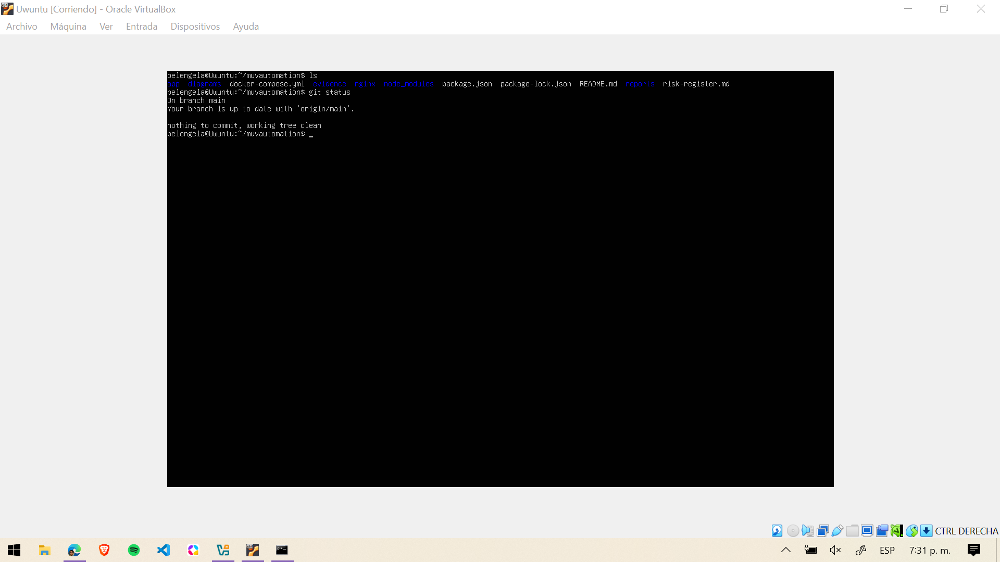

El historial identifica el commit que contiene la versión evaluada y los cambios
principales del laboratorio:

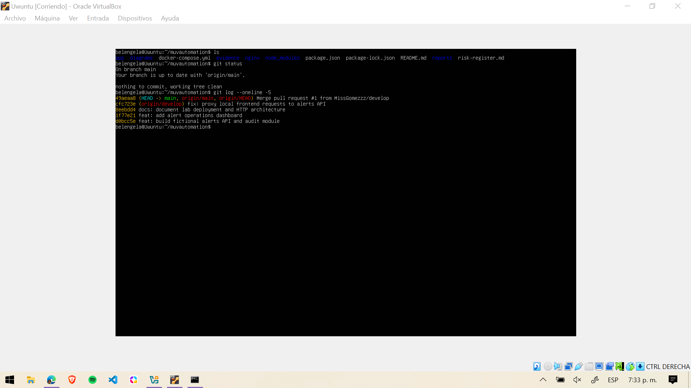

El listado confirma la existencia de `app/index.html` y de los archivos principales
del proyecto dentro del repositorio:

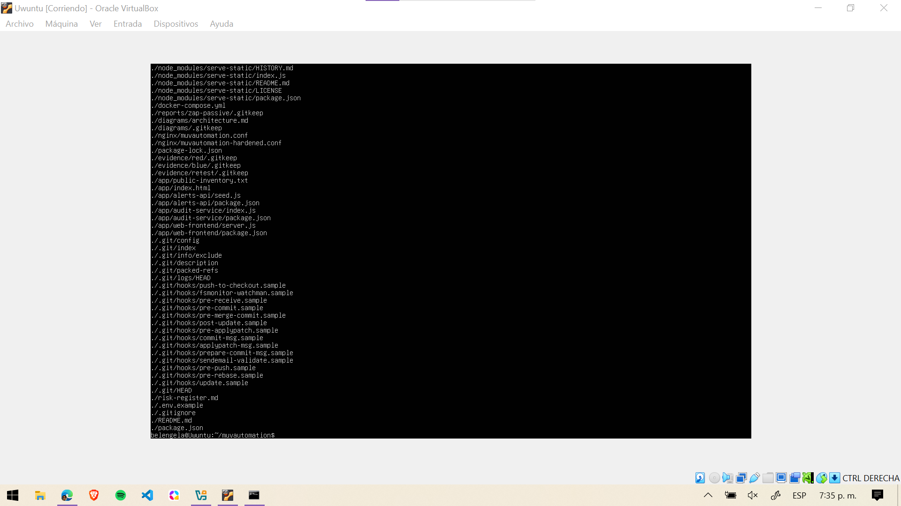

### Funcionamiento local y respuesta HTTP

El frontend se ejecutó localmente en `http://127.0.0.1:3000/` y se comprobó desde
el navegador:

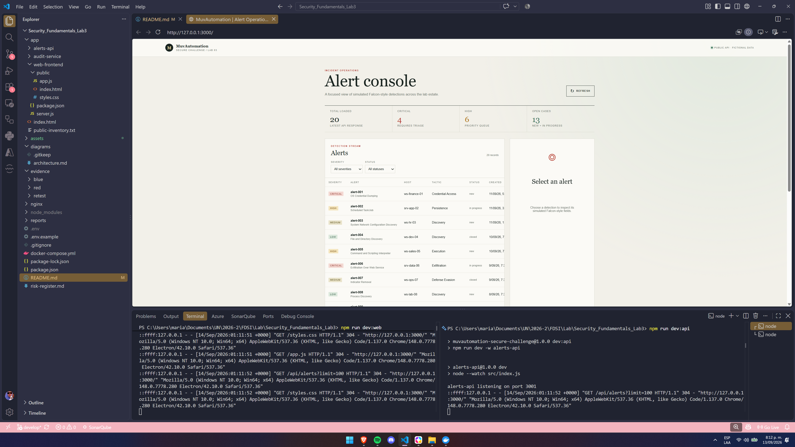

La respuesta obtenida con `curl` devuelve el documento HTML de la aplicación:

```bash
curl http://127.0.0.1:3000
```

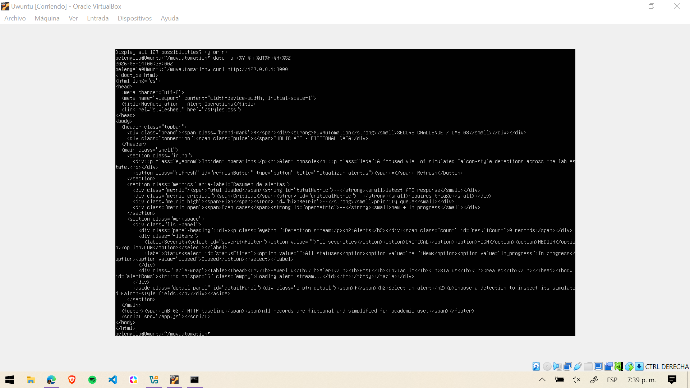

También se verificó la respuesta HTTP a través del punto publicado por Nginx:

```bash
curl -i http://127.0.0.1:8080/api/alerts
```

La captura muestra `HTTP/1.1 200 OK`, el servidor Nginx y la respuesta JSON del
endpoint:


La fecha y hora de la prueba se registraron con:

```bash
date -u +%Y-%m-%dT%H:%M:%SZ
```

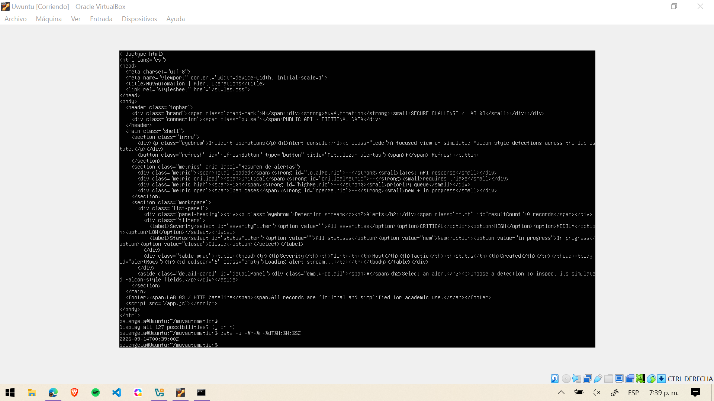

## 6. Evidencias del servidor y Nginx

Los servicios de la aplicación quedaron activos mediante PM2. La siguiente captura
muestra `alerts-api` y `web-frontend` en estado `online`:

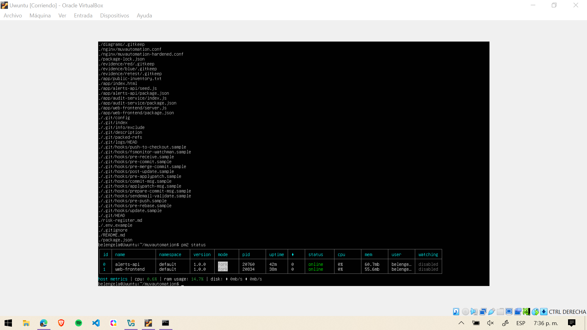

Esta segunda captura confirma el mismo estado operativo junto con el inventario del
proyecto en el servidor:

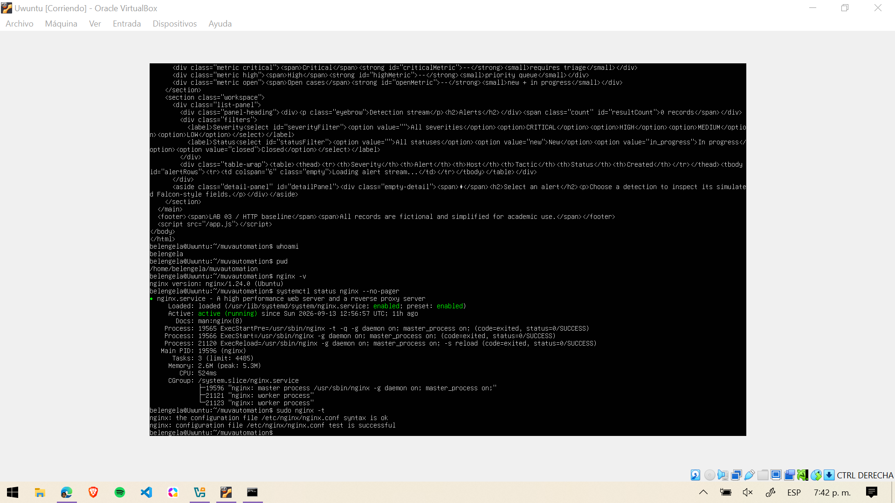

La comprobación del entorno del servidor incluyó `whoami`, `pwd`, la versión de
Nginx, el estado del servicio y la validación de sintaxis:

```bash
hostname
whoami
pwd
nginx -v
systemctl status nginx --no-pager
sudo nginx -t
```

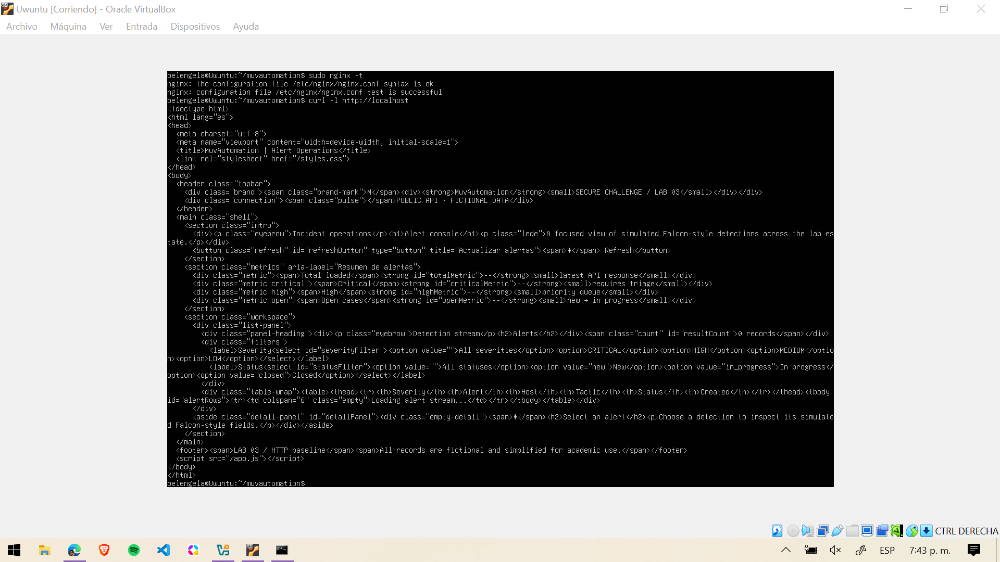

La respuesta de la API publicada por Nginx se verificó desde otro equipo mediante
`curl`, usando la dirección `http://127.0.0.1:8080/api/alerts`:

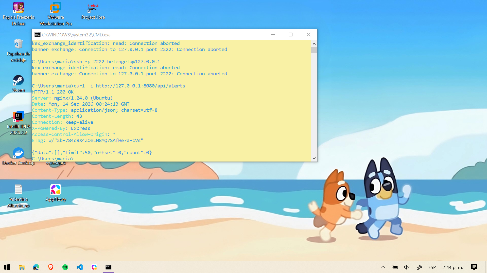

La misma dirección se abrió en el navegador para confirmar la publicación visual de
la aplicación:

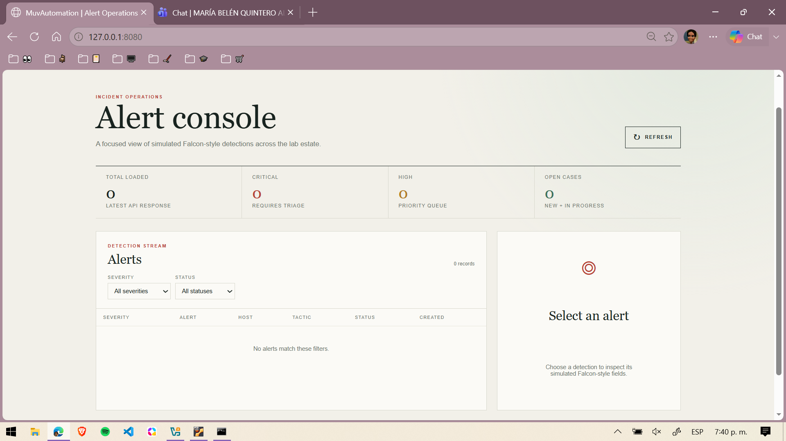

La respuesta HTML también se obtuvo desde el servidor con `curl` contra el frontend
local, lo que confirma el contenido publicado:


El archivo de configuración de Nginx utilizado en el servidor se muestra en la
siguiente captura:

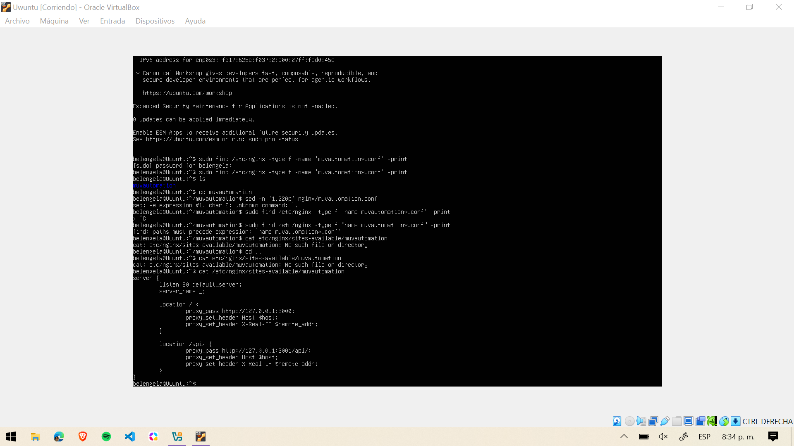

Los permisos y propietarios del directorio publicado se verificaron sobre
`/var/www/muvautomation/app/web-frontend/public`:

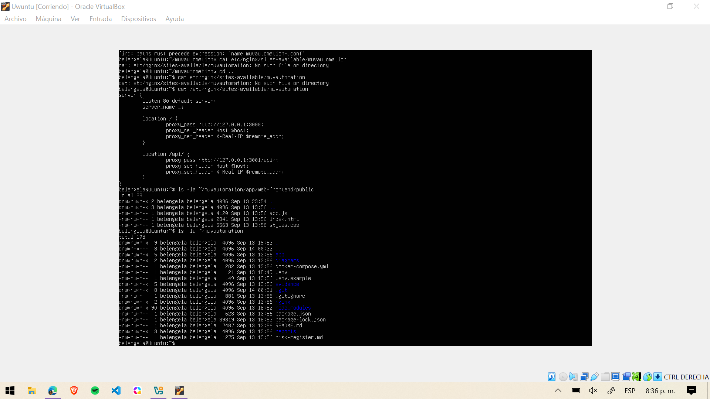

El extracto del registro de accesos confirma las solicitudes realizadas al sitio y
a la API:

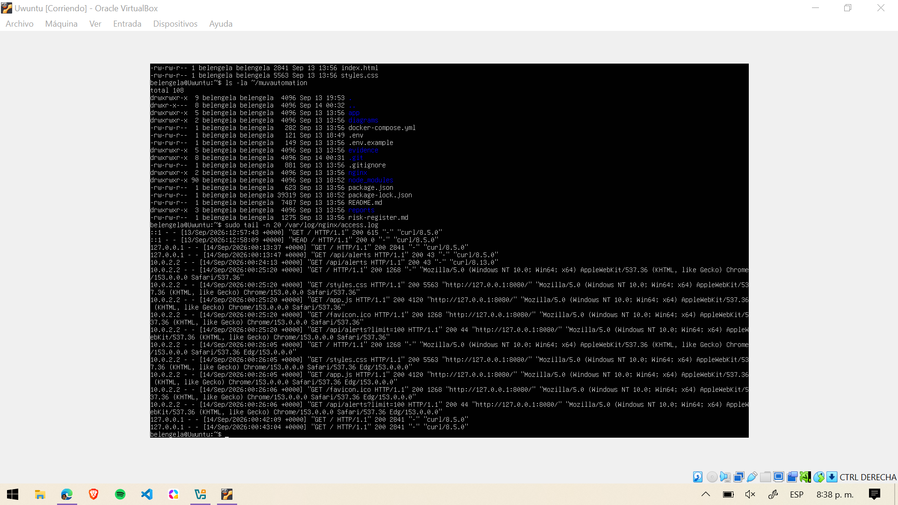

El extracto del registro de errores de Nginx también quedó documentado:

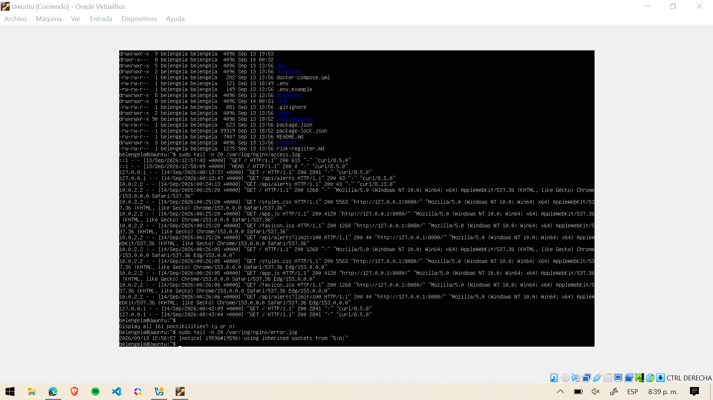

La configuración utilizada se encuentra versionada en
[`nginx/muvautomation.conf`](nginx/muvautomation.conf) y la variante endurecida en
[`nginx/muvautomation-hardened.conf`](nginx/muvautomation-hardened.conf). Los
extractos de `access.log`, `error.log` y la comprobación de permisos del directorio
publicado se incluyen también como capturas en esta sección.

No se incluyen contraseñas, tokens, llaves privadas ni secretos en estas capturas.

## Limitaciones de seguridad conocidas

Estas limitaciones son intencionales y forman parte del Lab 3:

- HTTP sin cifrar; no usar en producción.
- Sin autenticación ni autorización.
- El endpoint de API observado a través de Nginx todavía responde con `Access-Control-Allow-Origin: *`; la política CORS restringida del repositorio no quedó demostrada en el despliegue de la VM.
- La limitación de solicitudes sí está configurada y fue observada en el retest, pero no sustituye autenticación ni una protección anti-abuso completa.
- API pública con datos ficticios y endpoints de modificación.
- Logs locales sin pipeline centralizado ni retención configurada.
- Los placeholders de `.env.example` no son credenciales utilizables.

Las mitigaciones de HTTPS y autenticación se implementarán en el Laboratorio 4. No usar este prototipo con datos personales, tokens, API keys o credenciales reales.

## Evidencias de ejecución local

Los cambios del MVP se organizan en commits pequeños por slice funcional. Verificar la historia con:

```bash
git log --oneline --decorate -n 10
```

La evidencia disponible en [`evidence/retest/local-validation.md`](evidence/retest/local-validation.md)
documenta las pruebas locales de `alerts-api` en Windows. Se observaron los siguientes
resultados:

- PostgreSQL respondió en `localhost:5432` y `/health` devolvió HTTP 200 con
  `database: "ok"`.
- `GET /api/alerts` devolvió HTTP 200 y 20 alertas.
- CORS restringido funcionó localmente: `http://localhost:3000` fue aceptado y
  un origen no autorizado recibió HTTP 403.
- La solicitud preflight respondió HTTP 204.
- La comprobación de sintaxis `npm run check` terminó sin errores.
- La validación local dejó pendientes la consistencia de cabeceras y el hecho de que
  el proceso local escuchara en `0.0.0.0:3001`; esas pruebas no demuestran el estado
  del firewall ni la exposición de la VM.

Las capturas históricas del frontend y del repositorio se conservan en
[`assets/`](assets/), incluyendo el estado del repositorio, la ejecución local, las
respuestas HTTP y la fecha de prueba.

## Evidencias del servidor y Nginx

La evidencia del servidor confirma que Nginx quedó activo y que la configuración
pasó `sudo nginx -t`. Los archivos y capturas relevantes incluyen:

- [`nginx/muvautomation.conf`](nginx/muvautomation.conf) y
  [`nginx/muvautomation-hardened.conf`](nginx/muvautomation-hardened.conf).
- Las capturas de estado del servicio, publicación por navegador, configuración,
  permisos, `access.log` y `error.log` en [`assets/`](assets/).
- La prueba publicada de `GET /api/alerts` devolvió HTTP 200.

No deben incluir contraseñas, tokens, llaves privadas ni secretos.

## Modelo de amenazas inicial 

**Categorías STRIDE**: El uso de las categorías STRIDE está disponible en la siguiente [sección](risk-register.md).

**Mitigación propuesta y estado observado**:

- Centralizar el acceso público en Nginx y bloquear el acceso externo directo a
  frontend, API y PostgreSQL mediante UFW.
- Mantener PostgreSQL escuchando en localhost y permitir SSH únicamente desde las
  redes administrativas autorizadas.
- Aplicar cabeceras defensivas, bloquear rutas ocultas y limitar solicitudes en Nginx.
- Sustituir CORS abierto por una lista explícita de orígenes permitidos y verificar
  el despliegue efectivo de esa política.
- Implementar HTTPS antes de cualquier uso fuera del laboratorio.

El detalle por riesgo, junto con la evidencia y el estado de cada control, está en
[`risk-register.md`](risk-register.md).

# Segunda parte Laboratorio - Arquitectura fortalecida

La arquitectura fortalecida reduce la superficie de ataque al centralizar el acceso público en Nginx. El tráfico HTTP/HTTPS entra por los puertos 80/443, mientras que `web-frontend`, `alerts-api` y PostgreSQL permanecen en una zona interna restringida. El firewall define el límite de confianza y restringe el acceso administrativo y a los servicios internos.

Los controles incluyen limitación de solicitudes en Nginx, CORS restringido en la API, respuestas de error genéricas y restricciones de acceso a PostgreSQL. La configuración TLS debe admitir TLS 1.2 como mínimo y preferir TLS 1.3.

Diagrama de referencia: [`diagrams/hardened_dfd.png`](diagrams/hardened_dfd.png).

Los riesgos H6–H12 del registro complementan los riesgos iniciales H1–H5 y documentan las brechas asociadas a la arquitectura actual. Los resultados del retest se almacenan en [`evidence/retest/`](evidence/retest/), donde se comparan los escaneos de puertos antes y después y se registra el estado del firewall y la prueba de acceso directo a la API.


## Estado de seguridad y validación

### Controles implementados en el repositorio

La rama `feature/safe-architecture` contiene cambios destinados a fortalecer la arquitectura del laboratorio:

- Política CORS de lista permitida en `app/alerts-api/src/index.js`.
- Manejo de errores que evita exponer detalles internos en las respuestas de la API.
- Configuración endurecida de Nginx en `nginx/muvautomation-hardened.conf`, que incluye cabeceras de seguridad, restricciones de rutas ocultas y limitación de solicitudes.
- Registro de riesgos actualizado en `risk-register.md`.
- Estructura de evidencias para el retest en `evidence/retest/`.

La existencia de estas configuraciones en el repositorio no demuestra por sí sola que estén desplegadas ni que funcionen correctamente en las máquinas virtuales.

### Arquitectura objetivo

Nginx es el punto de entrada público previsto para la aplicación. El frontend, la API y PostgreSQL deben exponerse únicamente según las necesidades de la arquitectura. Los puertos internos no deben quedar accesibles desde redes no autorizadas.

- HTTP/HTTPS: únicamente los puertos habilitados deliberadamente en Nginx.
- Frontend y API: acceso a través del punto de entrada previsto, evitando el acceso externo directo a sus puertos internos.
- PostgreSQL: acceso restringido a los componentes que necesitan conectarse.
- SSH: acceso limitado a las direcciones o redes administrativas autorizadas.

La configuración final depende de si los componentes están en una misma VM o en máquinas separadas.

### Estado de las validaciones

Las pruebas locales permiten comprobar el comportamiento de la API, CORS, las
respuestas de error y la configuración del código. Las pruebas de exposición de
puertos, firewall y acceso desde una red externa se ejecutaron contra la VM y están
registradas en [`evidence/retest/`](evidence/retest/).

Resultados observados del retest:

| Control | Evidencia | Resultado |
|---|---|---|
| Acceso público por Nginx | `nmap_after.txt`, `curl_api_external.txt` | **PASS parcial:** HTTP/80 responde y la API publicada devuelve HTTP 200. |
| Bloqueo de servicios internos | `nmap_after.txt`, `ufw_status_numbered.txt` | **PASS desde el punto de observación usado:** 3000, 3001 y 5432 aparecen filtrados; UFW los deniega. |
| PostgreSQL | `pg_after.txt`, `ss_after.txt` | **PASS:** escucha en localhost y no se expone directamente por la red. |
| Ruta oculta | `hidden_path.txt` | **PASS:** `/.git/config` devuelve HTTP 403. |
| Cabeceras defensivas | `headers_after.txt` | **PASS:** se observan `server_tokens off`, `nosniff`, `DENY` y `no-referrer`. |
| Limitación de solicitudes | `limit_req_after.txt` | **PASS:** 28 respuestas HTTP 200 y 12 respuestas HTTP 503 durante la ráfaga. |
| CORS en el despliegue | `curl_api_external.txt` | **FAIL:** la respuesta publicada todavía contiene `Access-Control-Allow-Origin: *`. |
| HTTPS | `nmap_after.txt` | **BLOCKED/PENDIENTE:** 443 aparece filtrado y no existe evidencia de TLS configurado. |

El escaneo posterior también muestra SSH abierto. Esto es compatible con las reglas
UFW observadas porque solo se permiten las redes administrativas registradas; no debe
interpretarse como una exposición pública autorizada sin repetir la prueba desde una
red no administrativa.

No se considerará un control validado hasta disponer de evidencia del resultado observado.

### HTTPS y alcance del laboratorio

Si el despliegue actual utiliza únicamente HTTP, el tráfico entre el cliente y el punto de entrada no está protegido mediante TLS. HTTPS debe documentarse como pendiente cuando no esté configurado y probado. Si el laboratorio reserva TLS para una fase posterior, esta limitación debe quedar explícita en el registro de riesgos.

### Evidencia

Los resultados del retest se documentarán en `evidence/retest/`. Cada archivo debe indicar qué se probó, contra qué objetivo, desde dónde se ejecutó, cuándo se realizó y cuál fue el resultado. No deben registrarse contraseñas, tokens ni otros secretos.


## Uso responsable de IA

Antes de compartir logs, PCAP, IP, hostnames o usuarios con una herramienta de IA, anonimizar los datos del laboratorio. Validar manualmente toda conclusión contra el código, los comandos y la evidencia recolectada.


---
